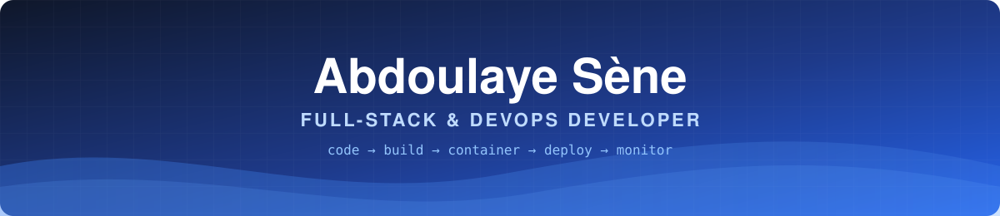
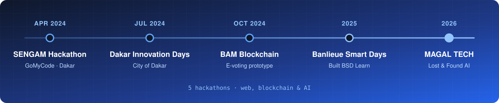

**I build web apps and ship them to test.**

📍 Malika, Dakar, Senegal &nbsp;·&nbsp; 🌍 Remote or on-site &nbsp;·&nbsp; 🗣️ French · English

---

## 👋 About me

- 💼 **Independent full-stack developer**: websites and web apps for organisations and businesses
- ⚙️ I handle **both the code and its operation**: Docker, CI/CD, GitOps (ArgoCD), observability (OpenTelemetry)
- 🏢 Previously **Full-Stack & DevOps Developer at Labdevit** (Dec 2025 – Aug 2026)
- 🎓 **M.Sc. in Software Engineering** at UN-CHK (M2 in progress)
- 🔬 Preparing a **PhD in AI for Software Engineering & DevOps** (start 2027–2028)
- 🤝 Open to **freelance projects, full-time roles and PhD positions**

## 🛠️ Tech stack

  <b>Frontend & Mobile</b>  
  

  <b>Backend & Databases</b>  
  

  <b>DevOps & Tools</b>  
  

## 🚀 Featured work

| Project | What it is | Stack |
| :-- | :-- | :-- |
| **[REVEIL ESPOIR](https://reveil-espoir.vercel.app)** | Website for a non-profit in Yeumbeul Nord: designed, built and deployed | Next.js · Vercel |
| **[TRUBUS Consortium](https://trubus-consortium.vercel.app)** | Showcase site for a real estate & business services firm, built from the client's posters | Next.js · static export |
| **[Smart Bibliothèque Banlieue](https://github.com/abdoulaye-26/SmartBibliothequeBanlieue)** | Free digital learning hub for the suburbs of Dakar (Banlieue Smart Days 2025) | MongoDB · Express · React · Node |
| **[TaskManager](https://github.com/abdoulaye-26/taskmanager-backend)** | Task management REST API + [web UI](https://github.com/abdoulaye-26/taskmanager-frontend) | Spring Boot 3 · Java 21 · PostgreSQL · Next.js |
| **[Hotel Booking Platform](https://github.com/abdoulaye-26/gestionHotel)** | Reservation and room management dashboard (Bakeli internship) | MERN |
| **[Learn Easy](https://github.com/abdoulaye-26/learn-easy)** | E-learning app with student, teacher and admin spaces | Python |

👉 More case studies on my **[portfolio](https://portfolio-next-rust-two.vercel.app)**.

## 🏆 Hackathons

---

**Let's work together.** Pick what fits and [send me an email](mailto:seneabdoulaye124@gmail.com).

